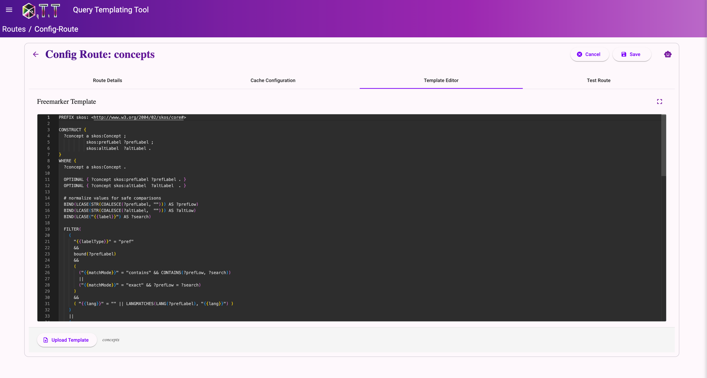

# Query Templating Tool (QTT)

Query Templating Tool (QTT) is a microservice platform that translates domain-specific search requests into optimized
SPARQL queries for graph database systems. It acts as a middleware layer between your applications and your knowledge
graph, simplifying data access through templated queries.



## How It Works

```
HTTP Request + Freemarker Template → SPARQL Query → Graph Studio Backend → JSON-LD Results
```

**Example Flow:**

1. Your application sends a simple JSON request:

```json
{
  "search_type": "email",
  "from": "joe@example.com",
  "limit": 500
}
```

2. QTT uses a Freemarker template to generate an optimized SPARQL query
3. The query executes against your Graph Studio graph database
4. Results are streamed back as JSON-LD

## Key Features

- **Template-Based Queries**: Write SPARQL queries once as Freemarker templates, reuse with different parameters
- **Dynamic Route Creation**: Create, modify, and deploy query endpoints without code changes
- **Multiple Database Backends**: Supports Derby (embedded), PostgreSQL, and SQL Server for metadata/route persistence
- **Real-Time Metrics**: Built-in performance monitoring and route analytics
- **Health Monitoring**: Automatic datasource health checks with configurable failure handling
- **Query Result Caching**: Optional Redis-backed caching layer to reduce database load and improve response times
- **AI-Powered Assistance**: Optional SPARQi assistant helps develop SPARQL templates using LLMs
- **Rich Web UI**: Angular-based interface for managing datasources, routes, and monitoring performance
- **RESTful API**: Complete programmatic access to all features
- **Camel Quarkus Runtime**: Runs as a single Camel Quarkus application on the JVM

## Use Cases

- **Simplified Knowledge Graph Access**: Hide SPARQL complexity from frontend developers
- **Multi-Tenant Graph Queries**: Route different clients to different graph layers
- **Query Performance Optimization**: Centralized template management and caching
- **Graph Data API Gateway**: Single endpoint for all graph database interactions
- **Semantic Search Services**: Build search APIs backed by ontology-driven queries

## Architecture Overview

QTT is built on a multi-module Maven project with these key components:

**Backend Modules:**

- **query-service-core**: RDF/JSON-LD serialization utilities
- **camel-anzo**: Custom Apache Camel component for Anzo integration
- **query-service-route-builder**: Dynamic Camel route creation from database templates
- **query-service-persistence**: JPA entities and services for routes, datasources, metrics
- **query-service-scheduler**: Cron jobs for metrics collection and cleanup
- **query-service-metrics**: JMX-based metrics collection
- **query-service-cache**: Redis-backed caching layer for query results
- **query-service-sparqi**: Optional AI assistant for template development
- **query-service-derby**: Embedded Derby support (driver, dialect, persistence unit); included by default, left
  out of native builds
- **query-service-app**: The Camel Quarkus application that assembles all modules into one runnable service and
  container image

**Frontend Module:**

- **query-service-web**: Angular web application (packaged into query-service-app)

**Runtime Architecture:**

The application runs on Camel Quarkus (Quarkus 3, Apache Camel 4, Java 17, JVM mode) and provides two separate HTTP
applications:

1. **Web UI and REST API** (Port 8443 - HTTPS; also plain HTTP on port 8080)
    - Static CRUD endpoints for routes, datasources, layers
    - SPARQi AI assistant API
    - Metrics and settings endpoints

2. **Query Endpoints** (`/query/{route-id}` on the same ports, Camel platform-http)
    - Dynamically created query endpoints based on database route definitions
    - Endpoint pattern: `https://localhost:8443/query/{route-id}?param=value`
    - Each route is open or requires an OIDC token with `qtt-query` or a QTT API key
      ([Securing the Query Endpoints](docs/administration.md#securing-the-query-endpoints))

## Quick Start

The fastest way to get QTT running is using the official Docker image:

```bash
# Pull the image
docker pull docker.io/inovexis/qtt:latest

# Run the container
docker run -d \
  --name qtt \
  -p 8443:8443 \
  docker.io/inovexis/qtt:latest
```

Access the application:

- **Web UI**: https://localhost:8443 (self-signed certificate by default)
- **API Base**: https://localhost:8443/queryrest/api/
- **Query Endpoints**: https://localhost:8443/query/{route-id}

The UI and API are also served over plain HTTP on port 8080 (add `-p 8080:8080`).

For detailed deployment options, see the [Administration Guide](docs/administration.md).

## Documentation

| Document                                             | Description                                                                   |
|------------------------------------------------------|-------------------------------------------------------------------------------|
| [Administration Guide](docs/administration.md)       | Docker, Podman, Docker Compose deployment, SSL/TLS, volumes, production setup |
| [Development Setup](docs/development-setup.md)       | Building from source, Makefile commands, local development environment        |
| [Configuration Reference](docs/configuration.md)     | Environment variables, configuration files, database backends                 |
| [User Guide](docs/user-guide.md)                     | Getting started tutorial, Web UI guide, creating routes and datasources       |
| [Template Development](docs/template-development.md) | Freemarker templates, SPARQL patterns, best practices                         |
| [API Reference](docs/api-reference.md)               | REST API documentation for all endpoints                                      |
| [SPARQi AI Assistant](docs/sparqi.md)                | Setup and usage of the AI-powered SPARQL assistant                            |
| [Troubleshooting](docs/troubleshooting.md)           | Common issues, monitoring, logging, performance tuning                        |
| [Advanced Topics](docs/advanced-topics.md)           | Database migration, high availability, backup/restore, security hardening     |

## System Requirements

**For Running with Docker/Podman:**

- Docker 20.10+ or Podman 3.0+
- 2GB RAM minimum (4GB recommended)
- 2GB disk space

**For Running from Source:**

- Java 17 (JDK)
- Apache Maven 3.6+
- Node.js v20.18.1
- Angular CLI 18.2.21

**For Production Deployment:**

- PostgreSQL 16+ or SQL Server 2019+ (recommended over embedded Derby)
- SSL certificates for HTTPS
- Optional: Redis 6.0+ for query result caching
- Optional: LLM provider access for SPARQi (OpenAI, Azure OpenAI, LiteLLM, etc.)

## License

This project is licensed under the MIT License - see the [LICENSE](LICENSE) file for details.

Copyright (c) 2025 RealmOne
